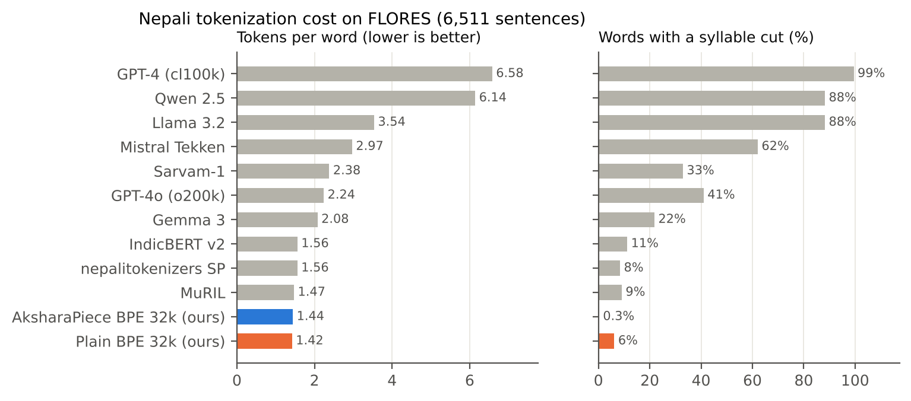
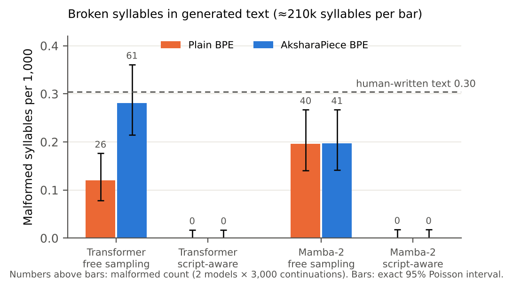
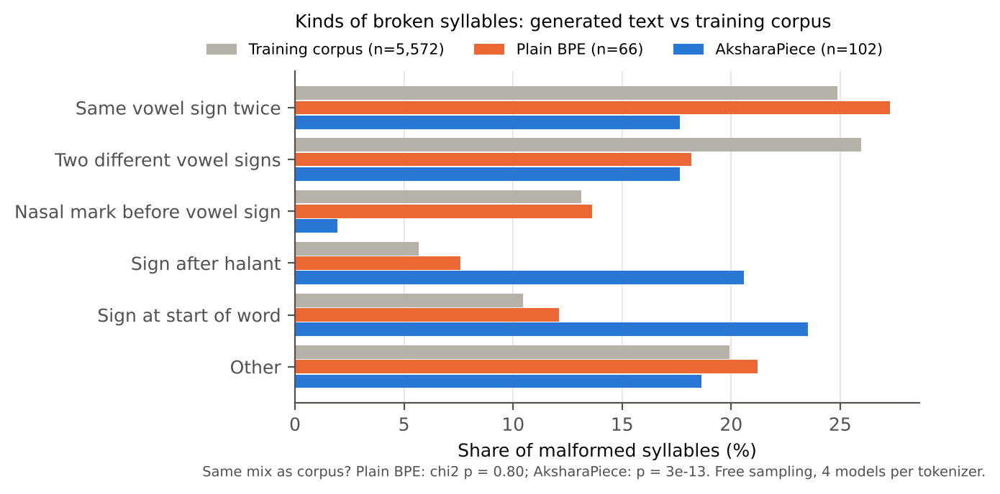

# AksharaPiece: syllable-aware tokenization for Nepali

Code, results and paper sources for

> **Keeping Syllables Whole Is Not Enough: Akshara-Aware Tokenization, Corpus Typos, and Script-Aware Decoding for Nepali Language Models**
> Sabin Bhattarai and Nabin Aadhikari, 2026

Subword tokenizers often cut Devanagari syllables (*aksharas*) in half, for example separating a vowel sign
from its consonant. **AksharaPiece** is a BPE tokenizer that never does this. We compared it with plain BPE under
matched conditions (same 600 MB of IndicCorp v2 text, same vocabulary, a Llama-style Transformer and Mamba-2,
three seeds each) and asked whether keeping syllables whole gives better Nepali language models.

**Models and tokenizers:** [huggingface.co/Sabinx877/aksharapiece-nepali](https://huggingface.co/Sabinx877/aksharapiece-nepali)
**Generated samples and scores:** [huggingface.co/datasets/Sabinx877/aksharapiece-nepali-eval](https://huggingface.co/datasets/Sabinx877/aksharapiece-nepali-eval)

## Main findings

| Question | Answer |
|---|---|
| Do general-purpose tokenizers cut Nepali syllables? | Yes. GPT-4's tokenizer cuts a syllable in 99.5% of words (6.6 tokens per word), GPT-4o in 41%, Gemma 3 in 22%. AksharaPiece: 0.3%, for 1.5% more tokens than plain BPE. |
| Does keeping syllables whole improve language modelling? | No reliable effect. Bits per byte differ by less than 0.4%, with no consistent direction across seeds. |
| Does it improve downstream classification? | No. np20ng news classification is about 83.5% (Transformer) and 84.1% (Mamba-2) for both tokenizers. |
| Does it produce cleaner Nepali text? | No. All models produce fewer broken syllables than human-written text (0.12 to 0.28 versus 0.30 per 1,000). AksharaPiece makes more of them with the Transformer (61 versus 26). |
| Where do broken syllables come from? | Plain BPE copies typos in the training corpus (legacy-font conversion errors such as `दुुई`, `हँुदै`). AksharaPiece makes its own kind, from how it encodes rare syllables. |
| How do we get rid of them? | **Script-aware decoding**: never let the model place a vowel sign or halant where it cannot attach. Zero broken syllables for both tokenizers, with no increase in non-words. |







## Quick start

```bash
git clone https://github.com/Sabinx87/aksharapiece && cd aksharapiece
pip install -r requirements.txt
PYTHONPATH=. pytest -q tests          # 50 tests
```

Split Nepali text into aksharas and use a tokenizer:

```python
from aksharapiece.akshara import aksharas, normalize, malformed_aksharas
print(aksharas(normalize("विद्यालयहरूमा")))     # ['वि', 'द्या', 'ल', 'य', 'ह', 'रू', 'मा']
print(malformed_aksharas("दुुई"))               # ['दुु']  (a doubled vowel sign)

from aksharapiece.codec import Codec           # tokenizers are on Hugging Face (tokenizers/ folder)
tok = Codec("akshara_bpe_16k.aksharapiece.json")
ids = tok.encode("नेपालको राजधानी काठमाडौं हो")
print(ids, tok.decode(ids))
```

Generate text with a trained model (downloads from Hugging Face):

```python
import sys
from huggingface_hub import snapshot_download
root = snapshot_download("Sabinx877/aksharapiece-nepali")
sys.path.insert(0, root + "/code")
from example import load, complete
model, codec = load("akshara_bpe_16k__transformer__s1", root=root)
print(complete(model, codec, ["नेपालको राजधानी"], constrained=True)[0])   # script-aware decoding
```

## Reproduce the experiments

Everything ran on free Kaggle GPUs. Each notebook in `notebooks/` carries this code inside it, so you only
import it into Kaggle (**Create → New Notebook → File → Import Notebook**), set the accelerator, and run.

| Notebook | What it does | Kaggle settings | Time |
|---|---|---|---|
| `1_tokenizer_audit.ipynb` | Audit of 12 tokenizers on FLORES, IndicCorp download and cleaning, pilot tokenizers | CPU, Internet on, `HF_TOKEN` secret (Read) for gated tokenizers | about 45 min |
| `2_train_models_seed0.ipynb` | Train both tokenizers (16k) and 4 language models (seed 0) | GPU T4 x2, Internet on | about 4.5 h |
| `3_train_models_seeds_1_2.ipynb` | The same 4 models with seeds 1 and 2, saves the models, paired bootstrap | GPU T4 x2 | about 4 h |
| `4_eval_generation_classification.ipynb` | np20ng classification and a first generation test (inputs: notebook 3) | GPU T4 x2, accept np20ng terms on Hugging Face | about 1.5 h |
| `5_generation_3000_constrained.ipynb` | 3,000 continuations per model, free and script-aware decoding, exact tests | GPU T4 x2 | about 40 min |
| `6_paper_figures.ipynb` | All figures and tables in the paper | CPU | 1 min |
| `7_publish_huggingface.ipynb` | Publishes models, tokenizers and samples to Hugging Face | CPU, `HF_WRITE_TOKEN` secret (Write) | 10 min |

Or run any step locally, for example:

```bash
python scripts/clean.py --inputs ne.txt --out data/clean
python scripts/train_tokenizers.py --train-file data/clean/tokenizer_train.txt --vocab 16000 --out data/tok
python scripts/train_lm.py --tokens data/tokens/akshara_bpe_16k --arch mamba --seed 1
python scripts/make_figures.py --out paper/figures
```

## Repository layout

| Path | Contents |
|---|---|
| `aksharapiece/akshara.py` | Normalization, the akshara splitter, malformed-syllable detection |
| `aksharapiece/tokenizer.py` | AksharaPiece (BPE or Unigram over aksharas) and the plain baseline |
| `aksharapiece/models.py` | Llama-style Transformer and Mamba-2 (chunked SSD scan in plain PyTorch) |
| `aksharapiece/codec.py` | One interface for every tokenizer file |
| `scripts/` | Cleaning, audit, tokenizer and LM training, evaluation, statistics, figures, release |
| `tests/` | 50 unit tests (splitter, scan against the recurrence, scoring, statistics) |
| `notebooks/` | The Kaggle notebooks that produced every result |
| `results/` | All result tables, run summaries and logs (samples and per-line scores are on Hugging Face) |
| `paper/` | LaTeX source (`main.tex`, `references.bib`) and figures |

## Citation

```bibtex
@misc{bhattarai2026aksharapiece,
  title  = {Keeping Syllables Whole Is Not Enough: Akshara-Aware Tokenization, Corpus Typos,
            and Script-Aware Decoding for Nepali Language Models},
  author = {Bhattarai, Sabin and Aadhikari, Nabin},
  year   = {2026},
  url    = {https://github.com/Sabinx87/aksharapiece}
}
```

## License

Code and models: Apache 2.0 (see `LICENSE`). Training data: IndicCorp v2 (CC0). Evaluation openings come from
FLORES (CC BY-SA 4.0); the np20ng dataset is not redistributed here.
